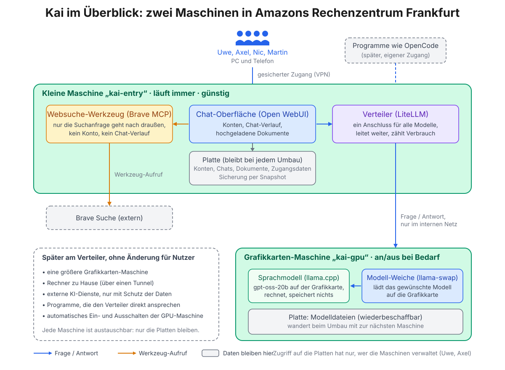

# Kai — unsere private KI

Kai ist ein gemeinsamer KI-Chat für vier Freunde. Er besteht aus zwei gemieteten Maschinen in Amazons Rechenzentrum Frankfurt, die wir selbst kontrollieren: einer **kleinen Maschine, die immer läuft** und Konten, Chat-Verlauf und Werkzeuge hält, und einer **Grafikkarten-Maschine**, auf der das Sprachmodell rechnet und die nur eingeschaltet wird, wenn wir sie brauchen. Niemand außer uns liest die Gespräche mit.

## So funktioniert es, in vier Sätzen

1. Du öffnest im Browser (PC oder Telefon) die **Chat-Oberfläche** auf der kleinen Maschine und meldest dich mit deinem Konto an.
2. Deine Frage geht über den **Verteiler** an das **Sprachmodell** auf der Grafikkarten-Maschine. Es antwortet und merkt sich nichts; dein Chat-Verlauf liegt in deinem Konto auf der kleinen Maschine.
3. Wenn es sinnvoll ist, benutzt das Modell ein **Werkzeug**, zunächst die Websuche von Brave, um aktuelle Informationen zu holen.
4. Ist die Grafikkarten-Maschine aus, bleibt die Oberfläche mit allen Verläufen erreichbar; das Modell meldet sich dann als „nicht erreichbar“, bis jemand die Maschine einschaltet.

## Was wo steht

| Für wen | Dokument |
|---|---|
| Alle | Dieses Blatt und die Bilder in [docs/bilder/](docs/bilder/) |
| Technisch Interessierte | [Architektur und Entscheidungen](docs/01_architektur.md) |
| Uwe (Infrastruktur) | [Anforderungen an Maschinen, Platten, Netz, Zugang](docs/02_anforderungen-infrastruktur.md) und die [Bestandsaufnahme der beiden Maschinen](docs/instance_specs.md) |
| Modellwahl | [Modellvorschlag für die T4-Grafikkarte](docs/03_modellvorschlag.md) |
| Vorgehen | [Plan: Phasen, Aufgaben, Prüfungen](docs/04_plan.md) |
| Admins | [compose/entry/.env.example](compose/entry/.env.example): welche Zugangsdaten gebraucht werden, und der Abschnitt „Für Admins“ unten |

## Kurzanleitung für Nutzer

1. **Adresse und Konto:** Die Adresse der Chat-Oberfläche und dein Konto bekommst du von Axel oder Uwe (der Zugangsweg ist noch offen, [Architektur §5](docs/01_architektur.md)). Das Passwort ist nur für dich; ändere es nach der ersten Anmeldung (Profil → Konto).
2. **Chatten:** Wähle oben das Modell und schreib los. PC und Telefon gehen im Browser, eine App brauchst du nicht.
3. **Websuche:** Schalte unter dem Eingabefeld das Werkzeug „Brave Search“ ein, wenn das Modell aktuelle Informationen aus dem Internet holen soll. Dabei geht der Suchtext an Brave; schreib also nichts hinein, was nicht nach draußen soll.
4. **Beim ersten Satz nach einer Pause** dauert die Antwort länger (das Modell wird geladen, 10 bis 40 Sekunden, auf einer frisch gestarteten Maschine mehr).
5. **„Modell nicht erreichbar“ oder Fehlermeldung nach etwa zwei Minuten:** Die Grafikkarten-Maschine ist aus. Sag Axel oder Uwe Bescheid, sie schalten sie ein; deine Verläufe bleiben erhalten.
6. **Datenschutz:** Gespräche liegen nur auf unserer Maschine in Frankfurt; der Admin der Oberfläche kann sie technisch einsehen.

## Für Admins

Ablauf auf einer frischen Maschine: [ansible/README.md, „Kai: Arbeitsablauf“](../ansible/README.md). Werkzeuge in `kai/bin/`:

| Skript | Wofür |
|---|---|
| `kai-pin-images` | Image-Tags mit Digest festschreiben (`--check` meldet ungepinnte Images) |
| `kai-models-pull` | Modelle aus `kai/models.list` laden, mit Prüfsumme |
| `kai-bootstrap` | Ersteinrichtung auf `kai-entry`: LiteLLM-Key, Admin-Konto, Verbindung, Konten aus einer Liste, Brave-Werkzeug, Registrierung schließen; wiederholbar; zeigt neue Startpasswörter einmalig an (in die KeePass), bei Wiederholung Admin-Passwort aus `KAI_ADMIN_PASSWORD` oder Abfrage |
| `kai-smoke` | Rauchtest nach dem Deployment: Healthchecks, Modellliste, ein Chat durch die ganze Kette |
| `kai-gpu` | `kai-gpu` per AWS-CLI starten, stoppen, abfragen (`status\|start\|stop`); Profil und Instanz-ID ausdrücklich angeben |

## Bausteine

| Maschine | Baustein | Was er tut | Software |
|---|---|---|---|
| kai-entry (läuft immer) | Chat-Oberfläche | Konten, Gespräche, Dokumente, Werkzeuge | [Open WebUI](https://github.com/open-webui/open-webui) |
| kai-entry | Verteiler | Ein Anschluss für Oberfläche und Programme; leitet jede Anfrage an die richtige Maschine und zählt den Verbrauch | [LiteLLM](https://github.com/BerriAI/litellm) |
| kai-entry | Websuche | Sucht im Internet, wenn das Modell es anfordert | [Brave Search MCP](https://github.com/brave/brave-search-mcp-server) |
| kai-gpu (bei Bedarf) | Modell-Weiche | Lädt das gewählte Modell auf die Grafikkarte, tauscht bei Bedarf | [llama-swap](https://github.com/mostlygeek/llama-swap) |
| kai-gpu | Modellserver | Rechnet die Antworten | [llama.cpp](https://github.com/ggml-org/llama.cpp) |
| kai-gpu | Erstes Modell | Allrounder, 21 Mrd. Parameter, passt in 16 GB | [gpt-oss-20b](https://huggingface.co/ggml-org/gpt-oss-20b-GGUF) |

Alles läuft in Docker-Containern und wird mit Ansible aus diesem Repository eingerichtet ([ansible/](../ansible/)). Beide Maschinen sind austauschbar: alles, was bleiben muss, liegt auf eigenen Platten, der Rest wird aus diesem Repository neu aufgebaut ([Architektur §3](docs/01_architektur.md#3-austauschbarkeit-die-maschine-ist-wegwerfware)).

## Was später dazukommt

Der Verteiler kann weitere Rechenknoten aufnehmen, ohne dass sich für die Nutzer etwas ändert: eine größere Grafikkarten-Maschine, Rechner zu Hause, externe KI-Dienste (nur mit Schutz der Daten) sowie Programme wie OpenCode, die den Verteiler direkt ansprechen. Automatisches Ein- und Ausschalten der Grafikkarten-Maschine gehört ebenfalls dazu. Siehe [Architektur §5](docs/01_architektur.md#5-ausblick-was-der-endpunkt-später-aufnimmt).

## Stand

Phase 1 (Design) in Abstimmung · Phase 2 (Skripte) fertig und gegen Test-VMs geprüft (Pull Requests im Fork) · Phase 3 (Umsetzung auf den AWS-Maschinen) wartet auf die Punkte aus [02 §8](docs/02_anforderungen-infrastruktur.md) · Aufgaben in ClickUp, Sprint 01.
