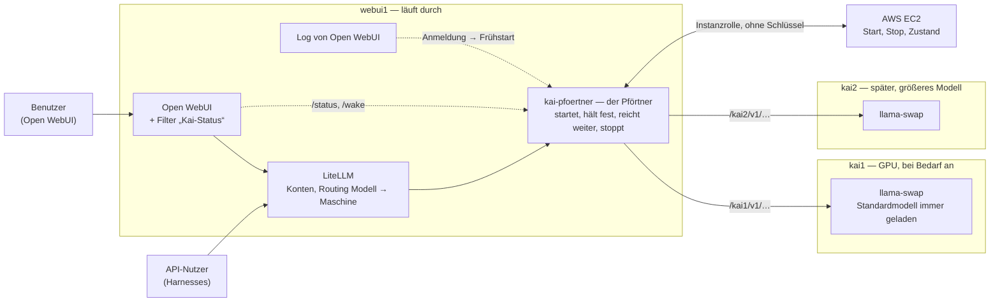
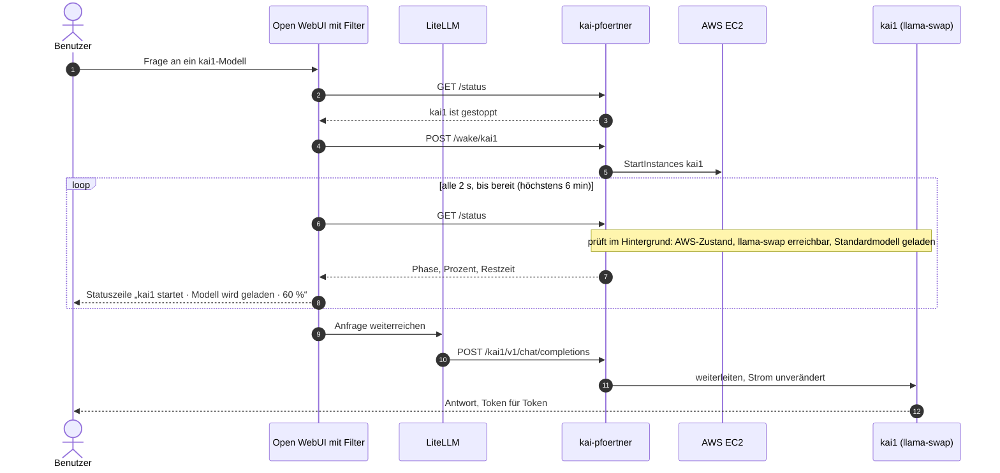
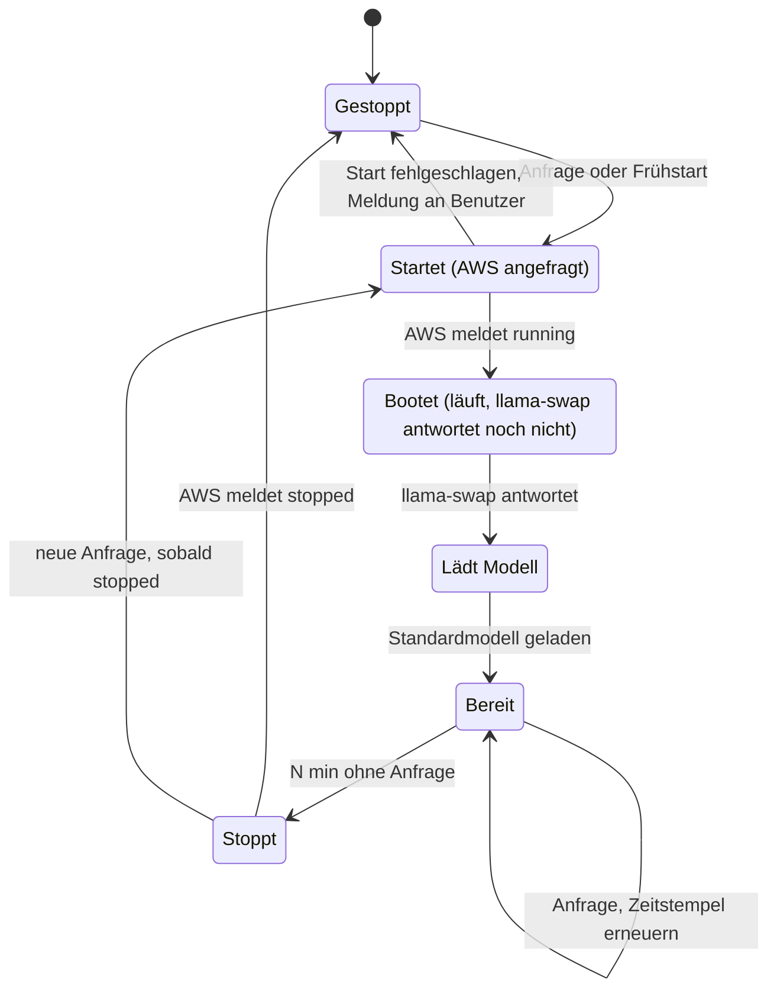
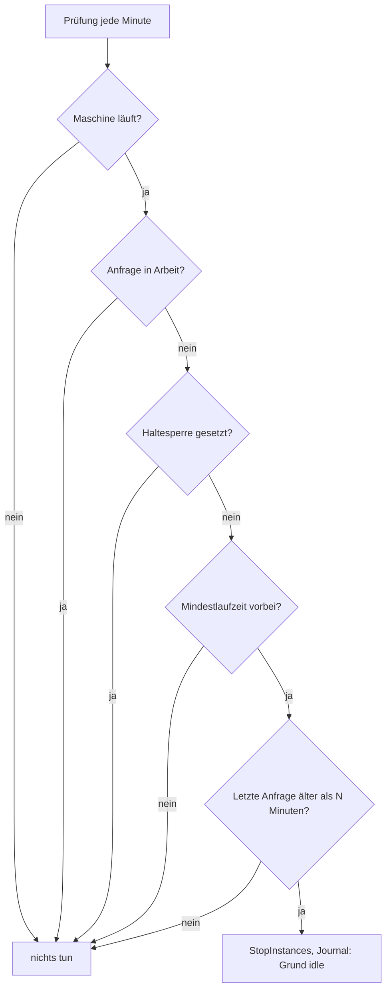

# Kai — Konzept: GPU-Maschinen bei Bedarf starten, nach Leerlauf stoppen

Stand: 10.11.2026. Pförtner, Ansible-Rolle und Filter sind gebaut und auf den Test-VMs im Heimnetz geprüft ([Abschnitt 8a](#8a-stand-der-umsetzung)); in AWS ist noch nichts ausgerollt, die Terraform-Seite und die Entscheidungen in [Abschnitt 10](#10-offene-entscheidungen) stehen aus.

## Kurzfassung

- `kai1` (die GPU-Maschine) kostet nur, während sie läuft. Heute startet und stoppt sie ein Mensch mit gültiger AWS-Sitzung.
- Neu übernimmt das ein kleiner Dienst auf `webui1`, der **Pförtner** (`kai-pfoertner`): Jede Anfrage an ein GPU-Modell geht durch ihn hindurch. Ist die Maschine aus, startet er sie, hält die Anfrage so lange fest und reicht sie dann weiter. Sieht er eine Weile keine Anfrage mehr, stoppt er die Maschine.
- Wer in Open WebUI chattet, sieht während des Starts eine Statuszeile mit Fortschritt („kai1 startet · Modell wird geladen · 60 % · noch etwa 40 s“) statt eines stummen Wartens.
- Auf `kai1` ist immer ein Modell geladen, mindestens das Standardmodell. „Kein Modell geladen“ ist deshalb kein Grund zum Stoppen; es zählt allein die Zeit seit der letzten Anfrage.
- Der Pförtner kennt mehrere Maschinen. Welche Maschine ein Modell braucht, entscheidet wie bisher LiteLLM; der Pförtner startet die Maschine, an die LiteLLM die Anfrage schickt.

## 1. Anlass

- Beim Testdeployment am 07./08.11.2026 lief die AWS-Sitzung zweimal ab, während `kai1` lief; gestoppt werden konnte die Maschine erst mit einer neuen Sitzung.
- `kai1` kostet im Betrieb ≈ 0,66 $/h ([02 §7.2](02_anforderungen-infrastruktur.md)); eine vergessene Nacht kostet mehr als ein Monat Root-Volume.
- Benutzer von Open WebUI haben keine AWS-Identität und können die Maschine nicht selbst starten ([01 §4](01_architektur.md)).

## 2. Ausgangslage: was ein Kaltstart kostet

| Phase | Dauer | Quelle |
|---|---|---|
| Startbefehl bis das Betriebssystem läuft | ≈ 45 s | SSM-Agent ≈ 1 min nach Start online, abzüglich Boot ([Bestandsaufnahme §1](instance_specs.md)) |
| Boot bis System bereit | 12 s | gemessen 07.11. |
| Docker, llama-swap, GPU-Initialisierung | wenige s | geschätzt |
| Modell laden (12–13 GB bei ≈ 125 MB/s) | ≈ 100 s | gemessen 08.11.: 98 s (S1-06) |
| **Summe bis zum ersten Token** | **≈ 2,5–3 min** | nicht als Ganzes gemessen |

```mermaid
gantt
  title Kaltstart von kai1 (Minuten:Sekunden)
  dateFormat X
  axisFormat %M:%S
  section AWS
  Startbefehl bis Betriebssystem laeuft   :a, 0, 45s
  section kai1
  Boot bis System bereit                   :b, after a, 12s
  Docker, llama-swap, GPU                  :c, after b, 10s
  Modell laden (98 s gemessen)             :d, after c, 98s
  section Benutzer
  erstes Token                             :milestone, m, after d, 0s
```



- Nach Stop/Start bootet die Maschine immer kalt, meist auf anderer Hardware; Arbeitsspeicher, Grafikspeicher und Instance Storage sind leer. Die EBS-Platten und die private IP bleiben, `kai1.unserkai.de` stimmt also weiter.
- **EC2-Hibernation scheidet aus:** AWS unterstützt sie für keine G-Familie und nicht für Debian ([Voraussetzungen](https://docs.aws.amazon.com/AWSEC2/latest/UserGuide/hibernating-prerequisites.html)); sie sichert ohnehin nur den Arbeitsspeicher, nicht den Grafikspeicher.
- Engpass ist die Lesegeschwindigkeit der EBS-Platte: die g4dn.xlarge schafft 118,75 MB/s dauerhaft und 437,5 MB/s als Burst (30 min je 24 h), gp3 liefert ohne Aufpreis 125 MB/s. Wie das zu verkürzen ist, steht in [Abschnitt 7](#7-schneller-starten).

## 3. Zielbild: der Pförtner `kai-pfoertner`



Was der Pförtner ist:

- Ein kleines Programm (Python, nur Debian-Pakete) als systemd-Dienst direkt auf `webui1`, nicht im Container. Grund: Nur die Maschine selbst bekommt von AWS die Zugangsdaten ihrer Instanzrolle; Container bekommen sie nicht. Er lauscht nur auf dem internen Docker-Netz von `webui1`, von außen ist kein neuer Port offen. Dienst, Programm, Befehl, Rechnername und AWS-Tag heißen `kai-pfoertner`; nur die Ansible-Rolle und ihre Variablen heißen `kai_pfoertner` und `kai_pfoertner_*`, weil Ansible dort keinen Bindestrich erlaubt (wie `kai_entry` für `kai-entry`).
- LiteLLM schickt Anfragen an GPU-Modelle nicht mehr direkt an `kai1:8080`, sondern an `kai-pfoertner:8081/kai1/v1/…`. Der Pfadanfang (`/kai1/`) sagt dem Pförtner, welche Maschine gemeint ist; er leitet an `kai1.unserkai.de:8080/v1/…` weiter. Eine zweite Maschine bekommt `/kai2/`.
- Je Maschine kennt er: Instanz-ID, Adresse, Leerlaufzeit, Mindestlaufzeit, ob sie beim Frühstart mitstartet. Keine Geheimnisse, keine AWS-Schlüssel; die Rechte kommen aus der Instanzrolle von `webui1` (siehe [Abschnitt 8](#8-was-wo-zu-bauen-ist)).

Was er tut:

| Anfrage | Verhalten |
|---|---|
| Chat, Completion, Embedding (`/v1/chat/completions`, …) | Maschine aus → starten, Anfrage festhalten, bei Bereitschaft weiterleiten. Maschine an → sofort weiterleiten. In beiden Fällen Zeitstempel „letzte Anfrage“ setzen. |
| Modellliste (`/v1/models`) | Aus der Konfiguration beantworten (dieselbe Modellliste, aus der Ansible auch LiteLLM füllt). Weckt nie. |
| `/health`, `/status` | Selbst beantworten: Zustand jeder Maschine, Phase, Prozent, geschätzte Restzeit, letzte Anfrage, geplanter Stopp. Weckt nie. |
| `/wake/<maschine>` | Start anstoßen, sofort antworten. Für den Filter in Open WebUI und den Frühstart. |
| `/hold/<maschine>?minutes=120` | Haltesperre: in dieser Zeit kein automatischer Stopp. Für Wartung oder Tests, die am Pförtner vorbei direkt mit `kai1` sprechen. |

Warum ein Pförtner *im* Datenweg und nicht nur daneben:

- Er sieht jede Anfrage, egal ob sie aus Open WebUI oder von einem API-Nutzer kommt. Damit kann er beides allein: wecken (die Anfrage kommt bei ihm an) und stoppen (er weiß, wann die letzte Anfrage endete und ob gerade eine läuft). Nichts muss in Open WebUI oder LiteLLM nachgebaut werden; der Filter in Open WebUI ist nur Komfort für die Anzeige.
- Der zusätzliche Hop kostet wenig: Der Pförtner läuft auf derselben Maschine wie LiteLLM, es kommt also kein Netzweg dazu, nur eine Schleife im Rechner. Geschätzt 1–3 ms je Anfrage und deutlich unter 1 ms je Token, solange er den Antwortstrom unverändert durchreicht (Pflicht, keine Zwischenspeicherung). Zum Vergleich: LiteLLM selbst braucht 10–50 ms je Anfrage, und `kai1` liefert ein Token alle 30–100 ms. Vor dem Festlegen wird das einmal gemessen ([Abschnitt 9](#9-messen-bevor-die-werte-feststehen)).
- Preis: Fällt der Pförtner aus, erreicht LiteLLM keine GPU-Maschine mehr. Darum: systemd startet ihn immer neu, der Code bleibt klein, und die alte direkte Adresse steht als Kommentar in der LiteLLM-Konfiguration, damit man im Notfall in einer Minute zurückschalten kann.

## 4. Wecken

### 4.1 Wann gilt eine Anfrage als absehbar?

Der Wunsch: Die Maschine startet, sobald mit einer Anfrage zu rechnen ist, nicht erst, wenn sie da ist. Was der Server davon sehen kann:

| Signal | Sieht der Server das? | Fehlstarts | Gewinn |
|---|---|---|---|
| Anmeldung in Open WebUI oder Seitenaufruf | Ja, im Log von Open WebUI | Wer sich anmeldet und dann nichts fragt | 20–60 s (die Zeit, in der jemand seine Frage tippt), bei einem Kaltstart von ≈ 3 min |
| Modell im Menü auswählen | Nein, das passiert nur im Browser | – | – |
| Tippen im Eingabefeld | Nein, das passiert nur im Browser | – | – |
| Frage abschicken (Anfrage an ein GPU-Modell) | Ja, im Filter von Open WebUI und im Pförtner | Keine | – (das ist der späteste Zeitpunkt) |

Vorgeschlagene Regel, zur Übernahme oder Abschwächung:

> Die Standard-GPU-Maschine startet, sobald sich jemand in Open WebUI anmeldet oder die Seite öffnet (**Frühstart**). Jede GPU-Maschine startet spätestens, wenn irgendwo eine Anfrage an eines ihrer Modelle eintrifft (**Pflichtstart**).

- Der Frühstart ist pro Maschine ein- oder ausschaltbar. Vorschlag: für `kai1` an, weil heute fast jede Nutzung dort landet; für eine spätere große Maschine aus, die startet nur auf Anfrage.
- Der Frühstart liest das Log von Open WebUI mit (Zeilen wie `POST /api/v1/auths/signin` und `GET /api/models`). Ändert sich das Logformat mit einer neuen Version, fällt nur der Frühstart weg, nie der Pflichtstart. Als Schutz vor dem Pendeln gilt nach jedem Start eine Mindestlaufzeit ([Abschnitt 5](#5-stoppen)).
- Optional: Frühstart nur in einem Zeitfenster (etwa 07–23 Uhr); nachts dann nur auf Anfrage.

### 4.2 Ablauf eines Kaltstarts aus Open WebUI



- Schritte 2–4 übernimmt der Filter in Open WebUI, ein kleines Python-Stück, das Open WebUI vor jeder Chat-Anfrage ausführt (global aktiv, einmal über die Admin-Oberfläche oder per `kai-bootstrap` eingespielt). Er fragt den Pförtner, zu welcher Maschine das gewählte Modell gehört und ob sie bereit ist.
- Kommt die Anfrage nicht aus Open WebUI (API-Nutzer), fehlen die Schritte 2–4 und die Statuszeile. Dann weckt der Pförtner in Schritt 10 selbst und hält die Anfrage fest, bis die Maschine bereit ist. Bei Stream-Anfragen schickt er alle 10 s ein Lebenszeichen (ein SSE-Kommentar, den Clients ignorieren), damit keine Verbindung wegen Stille abbricht. Dafür muss der Timeout in LiteLLM für GPU-Modelle von heute 180 s auf etwa 600 s steigen.
- Zwei gleichzeitige erste Anfragen starten die Maschine nur einmal: Der Pförtner führt pro Maschine genau einen Startvorgang, alle wartenden Anfragen laufen los, sobald er fertig ist.

### 4.3 Zustände einer GPU-Maschine aus Sicht des Pförtners



- „Stoppt“ dauert 30–60 s. Eine Anfrage in dieser Zeit wartet, bis AWS „stopped“ meldet, dann startet der Pförtner neu; AWS kann eine stoppende Maschine nicht direkt wieder starten.

### 4.4 Fortschrittsanzeige

Der Pförtner meldet in `/status` eine Phase und einen Prozentwert. Die Prozentwerte innerhalb einer Phase schätzt er aus der Dauer der letzten Starts, die er sich merkt; die Anzeige wird also mit jedem Start genauer.

| Phase | Woran der Pförtner sie erkennt | Anteil | Typische Dauer |
|---|---|---|---|
| Start angefragt | `StartInstances` abgeschickt | 0–10 % | wenige s |
| Maschine läuft, bootet | AWS meldet `running` | 10–35 % | ≈ 45 s |
| Dienst startet | llama-swap antwortet auf `/health` | 35–50 % | ≈ 20 s |
| Modell wird geladen | llama-swap meldet das gewünschte Modell noch nicht als geladen (`/running` bzw. Health des Modells) | 50–95 % | ≈ 100 s, später kürzer ([Abschnitt 7](#7-schneller-starten)) |
| Bereit | gewünschtes Modell geladen | 100 % | – |

In Open WebUI erscheint das als Statuszeile über der entstehenden Antwort, etwa:

```
⟳ kai1 startet · Modell wird geladen · ▰▰▰▰▰▰▱▱▱▱ 60 % · noch etwa 40 s
```

**Welches Modell geladen wird, bestimmt der Pförtner, nicht ein starres Preload.** llama-swap hält auf der einen GPU genau ein Modell (16 GB Grafikspeicher, ein Modell braucht 12–13 GB). Würde llama-swap beim Start immer Modell A vorladen und die erste Anfrage will Modell B, müsste B warten, bis A fertig geladen ist, dann A entladen und B laden: zweimal ≈ 100 s für ein Modell, das niemand benutzt. Darum stößt der Pförtner das Laden selbst an, sobald llama-swap antwortet: beim Pflichtstart das Modell aus der Anfrage, beim Frühstart (nur die Anmeldung ist bekannt) das Standardmodell. So wird genau einmal geladen. Einzige Ausnahme: Nach einem Frühstart kommt eine Anfrage nach B, während das Standardmodell A noch lädt; dann bleibt der Wechsel A → B. Das trifft nur Nicht-Standard-Modelle und ist der Preis des Frühstarts.

Sobald die Maschine bereit ist, schließt der Filter die Statuszeile („kai1 bereit“) und die Antwort beginnt wie gewohnt. Die Technik dahinter ist die Statusmeldung, die Open WebUI für Filter vorsieht (`__event_emitter__`, Typ `status`); sie zeigt eine Zeile mit Text, keinen Balken, darum zeichnet der Filter den Balken mit Zeichen.

### 4.5 Fehlerfälle

| Fall | Verhalten |
|---|---|
| AWS hat gerade keine GPU dieser Größe frei (`InsufficientInstanceCapacity`; möglich, weil das Volume `kai1` an eine Verfügbarkeitszone bindet) | Pförtner versucht es alle 30 s erneut, bis zu 10 min; Statuszeile: „AWS hat gerade keine GPU frei, neuer Versuch in 30 s“. |
| Maschine läuft, llama-swap antwortet nicht (Container defekt) | Keine Automatik (kein Neustart der Maschine); `/status` meldet „Maschine läuft, Dienst antwortet nicht“, Anfragen bekommen nach 2 min einen klaren Fehler. |
| Start dauert länger als 6 min | Anfragen bekommen einen Fehler 503 mit JSON-Meldung („kai1 konnte nicht gestartet werden: …“); die Maschine bleibt an, der nächste Versuch läuft normal. |
| Pförtner selbst ausgefallen | systemd startet ihn neu; solange er fehlt, meldet LiteLLM das Modell als nicht erreichbar, Open WebUI zeigt das ehrlich an. |

Jeder Start und jeder Stopp landet mit Grund im Journal von `webui1` (`request`, `login`, `idle`, `hold abgelaufen`, Fehlertext).

## 5. Stoppen

Es gilt ein einziges Kriterium: **Zeit seit der letzten Anfrage.** Ob und welches Modell geladen ist, spielt keine Rolle; auf `kai1` ist immer ein Modell geladen: nach dem Start das angeforderte oder das Standardmodell (der Pförtner lässt es laden, llama-swap entlädt nie, `ttl: 0`), später das zuletzt benutzte.



- **Leerlaufzeit N:** Vorschlag 30 min. 30 min Leerlauf kosten ≈ 0,33 $; ein Kaltstart kostet jeden Wartenden ≈ 3 min. Sehr kurze Werte sparen wenig und ärgern viel.
- **Mindestlaufzeit:** Vorschlag 10 min ab Start. Sonst würde ein Frühstart ohne folgende Anfrage sofort wieder gestoppt.
- **Anfrage in Arbeit:** Eine Antwort, die noch streamt, zählt als Anfrage in Arbeit; der Zeitstempel wird erst am Ende gesetzt.
- **Haltesperre:** Für Arbeiten, die der Pförtner nicht sieht (SSH-Tunnel direkt nach `kai1`, Modelle nachladen): `kai-pfoertner hold kai1 120` auf `webui1` oder `POST /hold/kai1?minutes=120`.
- **Konfiguration je Maschine** in den Ansible-Variablen: `idle_minutes: 30`, `min_runtime_minutes: 10`, `wake_on_login: true`. `idle_minutes: 0` heißt „nie stoppen“. Das ersetzt den früheren Vorschlag eines Schalters `kai_gpu_idle_stop`; gemeint war damit nur eine Ansible-Variable, die den Stopper auf den Test-VMs im Heimnetz aus- und auf `kai1` einschaltet.
- **Sicherheitsnetz außerhalb der Maschine:** ein CloudWatch-Alarm (AWS-eigene Überwachung) mit der Aktion „Stop“, wenn die CPU von `kai1` 90 min lang unter 5 % bleibt. Er greift nur, wenn der Pförtner ausgefallen ist oder hängt; im Normalfall hat der Pförtner längst gestoppt. Kosten ≈ 0,10 $/Monat. Ein nächtlicher Zwangsstopp (02:00 Uhr) wäre die gröbere Alternative.

### Gestaffelte Stopper

Drei Stufen sind denkbar. Regel für jede Staffelung: Jede Stufe ist deutlich gröber als die vorige und greift nur, wenn die feinere ausgefallen ist; zwei Stufen mit ähnlichen Zeiten würden sich gegenseitig in die Quere kommen.

| Stufe | Wo | Signal | Zeit | Fängt ab | Kosten |
|---|---|---|---|---|---|
| 1 Pförtner | `webui1` | letzte Anfrage, Haltesperre | 30 min | den Normalfall | im Pförtner enthalten |
| 2 Selbst-Stopper | `kai1`, systemd-Timer mit `poweroff` | Lebenszeichen des Pförtners bleibt aus (er ruft `/health` ohnehin jede Minute) | 60 min | Pförtner oder `webui1` tot; dann kann ohnehin niemand `kai1` nutzen | zweite Komponente, auf der Test-VM nur im Trockenmodus prüfbar; ein Admin, der bei totem Pförtner per SSH arbeitet, muss den Timer anhalten |
| 3 AWS von außen | CloudWatch-Alarm | CPU unter 5 % | 90 min | alles, was auf beiden Maschinen hängt, auch Stufe 1 und 2 | ≈ 0,10 $/Monat |

Empfehlung: Stufe 1 und 3 bauen, Stufe 2 nur, wenn Stufe 3 nicht gewünscht ist oder die Messung zeigt, dass die CPU im Leerlauf kein verlässliches Signal ist. Stufe 2 schließt nur die Lücke zwischen 60 und 90 min nach einem Ausfall des Pförtners, also ≈ 0,33 $ je seltenem Ereignis, und kostet dafür Code, Tests und einen zweiten Akteur auf `kai1`. Fällt Stufe 2 später doch nötig aus, ist das Lebenszeichen das einfachste Signal: kein Lesen von Metriken aus llama-swap, keine Versionsabhängigkeit.

Warum der Stopper im Pförtner sitzt und nicht auf `kai1` selbst: Der Pförtner weiß ohne Umwege, wann die letzte Anfrage endete und ob gerade eine läuft; `kai1` müsste das aus llama-swap herauslesen (Metrik-Endpunkt, versionsabhängig) und sähe trotzdem keine Haltesperre. Außerdem gilt dieselbe Logik unverändert für jede weitere Maschine.

## 6. Mehrere GPU-Maschinen

- LiteLLM bleibt die einzige Stelle, die entscheidet, welches Modell auf welcher Maschine läuft (`model_list`). Dort zeigt `api_base` je Modell auf `http://kai-pfoertner:8081/<maschine>/v1`.
- Der Pförtner hat eine Tabelle je Maschine (Instanz-ID, Adresse, Leerlaufzeit, Mindestlaufzeit, Frühstart). Ansible erzeugt beide, LiteLLM-Konfiguration und Pförtner-Tabelle, aus derselben Inventory-Variable, damit sie nicht auseinanderlaufen.
- Jede Maschine hat ihren eigenen Zustand, Start, Stopp und Zeitstempel. Eine Anfrage an ein Modell von `kai2` startet nur `kai2`.
- Die AWS-Berechtigung von `webui1` gilt für alle Instanzen mit einem Tag (etwa `kai-pfoertner = managed`), nicht für eine feste Liste; eine neue Maschine braucht nur das Tag.
- Der Filter in Open WebUI ist maschinenunabhängig: Er fragt den Pförtner, zu welcher Maschine das gewählte Modell gehört.

## 7. Schneller starten

| Maßnahme | Wirkung | Kosten |
|---|---|---|
| Laden ab Boot (durch den Pförtner, siehe [4.4](#44-fortschrittsanzeige); das starre `kai_gpu_preload` entfällt) | Modell lädt, sobald llama-swap läuft, statt ab erster Anfrage; Voraussetzung dafür, dass der Frühstart wirkt | keine |
| gp3-Durchsatz von `kai-models` auf ≈ 400 MiB/s (mehr kann die g4dn.xlarge nicht) | Modell ≈ 30 s statt ≈ 100 s | ≈ 15 $/Monat; 250 MiB/s: ≈ 50 s für ≈ 6 $/Monat; ohne Ausfall änderbar |
| `apt-daily` und `unattended-upgrades` nach dem Boot verzögern (umgesetzt mit der Rolle `kai_updates`: erster Lauf 8 min nach dem Boot) | wenige s; sie teilen die Plattengeschwindigkeit mit dem Modell | keine |

Vor dem Anheben des Durchsatzes wird gemessen, ob llama.cpp das Tempo beim Laden überhaupt abruft (`dd` gegen die Ladezeit, sonst `--no-mmap`).

Erwartung mit Pförtner, Frühstart und schnellerer Platte: Wer sich anmeldet und tippt, wartet ≈ 30–60 s; wer sofort fragt, ≈ 1,5 min; heute ≈ 3 min.

## 8. Was wo zu bauen ist

| Nr. | Seite | Was | Fertig, wenn |
|---|---|---|---|
| 1 | AWS, Terraform (`aws/`) | Instanzrolle von `webui1` darf `ec2:StartInstances` und `ec2:StopInstances` auf Instanzen mit Tag `kai-pfoertner = managed` und `ec2:DescribeInstances` lesen; `kai1` bekommt das Tag; CloudWatch-Alarm als Sicherheitsnetz; Berechtigungen und Terraform-Code in [07](07_aws-berechtigungen-pfoertner.md) | `aws ec2 start-instances` von `webui1` aus klappt für `kai1` und wird für andere Instanzen abgelehnt |
| 2 | `kai1`, Rolle `kai_gpu` | `kai_gpu_preload` auf `[]` setzen, das Laden übernimmt der Pförtner; sonst nichts (llama-swap startet schon mit der Maschine) | Nach einem Kaltstart über den Pförtner ist genau ein Modell geladen, das angeforderte |
| 3 | `webui1`, neue Rolle `kai_pfoertner` | Pförtner als systemd-Dienst, Konfiguration aus dem Inventory, Journal-Einträge; LiteLLM-`api_base` auf den Pförtner, Timeout 600 s; auf den Test-VMs im Heimnetz läuft er im Trockenmodus (`provider: none`: Start und Stopp nur als Logzeile, Gegenstelle gilt als an) | Test-VM zweimal durchgelaufen, zweiter Lauf `changed=0`; `kai-smoke` grün; aus Open WebUI startet eine Frage die gestoppte `kai1`, die Antwort kommt innerhalb von 3 min; zwei gleichzeitige erste Fragen starten nur einmal |
| 4 | `webui1`, Rolle `kai_pfoertner` | Stopper mit Leerlaufzeit, Mindestlaufzeit, Haltesperre | Nach N min ohne Anfrage zeigt das Journal den Stopp und AWS `stopped`; eine Haltesperre verhindert ihn |
| 5 | Open WebUI | Filter „Kai-Status“ (Statuszeile mit Fortschritt), eingespielt per `kai-bootstrap` | Statuszeile erscheint beim Kaltstart und schließt sich bei Bereitschaft |
| 6 | `webui1`, Rolle `kai_pfoertner` | Frühstart aus dem Log von Open WebUI, pro Maschine schaltbar | Anmeldung startet `kai1`, Journal-Grund `login` |
| 7 | AWS | gp3-Durchsatz von `kai-models` anheben, falls [Abschnitt 10](#10-offene-entscheidungen) das vorsieht | Ladezeit neu gemessen |

Randbedingungen: keine langlebigen AWS-Schlüssel; kein neuer Port nach außen auf `webui1`; keine Änderung an der Security Group von `kai1`; keine interne Adresse im Repo (`kai1.unserkai.de` ist in Ordnung). Was LiteLLM an automatischen Prüfungen anbietet (`background_health_checks`), bleibt aus, sonst würde ein Prüfruf die Maschine wecken.

## 8a. Stand der Umsetzung

Gebaut ist alles aus den Zeilen 3–6 der Tabelle oben (Zeile 1 ist AWS-Seite, siehe [07](07_aws-berechtigungen-pfoertner.md); Zeile 7 steht aus):

| Teil | Wo im Repo |
|---|---|
| Pförtner (Python, nur Standardbibliothek, `boto3` aus Debian nur für den echten AWS-Betrieb) | `kai/bin/kai-pfoertner` |
| Ansible-Rolle `kai_pfoertner` (vor `kai_entry`), Betriebswerte in `ansible/inventory/group_vars/kai_entry.yml`; `kai_pfoertner_enabled: false` schaltet auf direkten Zugriff zurück und stoppt den Pförtner | `ansible/roles/kai_pfoertner/` |
| LiteLLM zeigt auf den Pförtner (`api_base`), Timeout 600 s; `kai_gpu_preload: []` | `kai/compose/entry/litellm.yaml.j2`, `group_vars` |
| Filter „Kai-Status“, eingespielt von `kai-bootstrap` (Schritt `status-filter`) | `kai/openwebui/kai_status_filter.py` |
| Automatische Tests (12 Fälle: Wecken, Strom, Lebenszeichen, Start nur einmal, Leerlaufstopp, Haltesperre, Kapazitätsfehler, Fehlstart, laufende Anfrage verhindert Stopp, Fortschritt) | `kai/tests/test_kai_pfoertner.py`, Aufruf `python3 kai/tests/test_kai_pfoertner.py` |

Geprüft auf `kai-entry-pre` und `kai-gpu-pre` (am 10.11.2026):

- Beide Deploys laufen durch, der zweite Lauf auf `kai-entry-pre` meldet `changed=0`.
- Kette Open WebUI / `curl` → LiteLLM → Pförtner → llama-swap antwortet, mit und ohne Stream. Dabei fiel ein Fehler auf, den die automatischen Tests nicht fanden: Der Pförtner schickte den Header `Server` doppelt, LiteLLMs Client lehnt das ab; behoben, mit eigenem Test.
- Wecken mit simuliertem AWS (`provider: sim`, 20 s Start): eine Anfrage über LiteLLM an die „gestoppte“ Maschine kommt nach 22 s beantwortet an; das Journal zeigt die Phasen.
- Leerlaufstopp (Test mit 2 min): Stopp um 18:44:00, 2:34 min nach der letzten Anfrage (Prüfung im Minutentakt).
- Frühstart: Ein Anmeldeversuch in Open WebUI (`POST /api/v1/auths/signin`) erscheint im Log und setzt die Aktivität des Pförtners zurück.
- Filter: gegen die gestoppte Maschine zeigt er alle 2 s eine Zeile (`⟳ kai1 startet · Maschine bootet · ▰▰▱▱▱▱▱▱▱▱ 23 % · noch etwa 75 s`) und zum Schluss „✔ kai1 bereit“; für Modelle ohne GPU-Maschine bleibt er still.
- **Verzögerung durch den Hop** (Test-VM, Antwort mit einem Token, jeweils 6 Läufe): bis zum ersten Byte 2–6 ms über den Pförtner, 4–8 ms direkt; Gesamtzeit 19–22 ms in beiden Fällen. Der Hop ist nicht messbar; AWS-Werte stehen aus.

Nicht geprüft, weil nur in AWS möglich: echtes `StartInstances`/`StopInstances` und die Instanzrolle (`provider: aws`), die echte Dauer eines Kaltstarts, die Zeile „Anmeldung“ mit einem echten Konto im Log, sowie die Anzeige der Statuszeile im Browser (der Filter wurde im Open-WebUI-Container direkt aufgerufen).

## 9. Messen, bevor die Werte feststehen

| Messung | Wozu | Wie |
|---|---|---|
| Verzögerung durch den Pförtner | Bestätigen, dass der Hop nicht spürbar ist | Auf `webui1` dieselbe Anfrage einmal direkt an `kai1:8080`, einmal über `kai-pfoertner:8081/kai1`, mit und ohne Stream; `curl -w` mit Gesamtzeit und Zeit bis zum ersten Byte |
| Kaltstart von Ende zu Ende | Phasenanteile und Timeouts | Zeitstempel im Journal des Pförtners, vom `StartInstances` bis „Bereit“ |
| Ladezeit des Modells bei 125, 250, 400 MiB/s | Entscheidung über den gp3-Durchsatz | Journal des Pförtners, Phase „Modell wird geladen“ |
| CPU von `kai1` im Leerlauf mit geladenem Modell | Schwelle des CloudWatch-Alarms | CloudWatch-Metrik über einen Tag |
| Anmeldung im Log von Open WebUI sichtbar? | Ob der Frühstart so gebaut werden kann | `docker logs` auf `webui1` bei einer Anmeldung |

## 10. Offene Entscheidungen

1. Leerlaufzeit (Vorschlag 30 min) und Mindestlaufzeit (Vorschlag 10 min).
2. Frühstart bei Anmeldung: ja oder nein; wenn ja, rund um die Uhr oder nur tagsüber.
3. Sicherheitsnetz: CloudWatch-Alarm (empfohlen) oder nächtlicher Zwangsstopp.
4. gp3-Durchsatz von `kai-models`: 125 (heute), 250 oder 400 MiB/s.
5. API-Nutzer beim Kaltstart: Anfrage festhalten (empfohlen) oder sofort 503 mit „bitte in 3 min erneut“.

## 11. Nicht gewählt

- **`kai1` dauernd laufen lassen:** On-Demand ≈ 480 $/Monat, Spot ≈ 170–240 $/Monat (0,23–0,33 $/h in Frankfurt, 15–20 % Unterbrechungen); Spot senkt Kosten, nicht die Wartezeit.
- **Ruhezustand** (EC2-Hibernation oder im Gast): von AWS für diese Maschine nicht unterstützt, mit GPU auf neuer Hardware unberechenbar, und nicht schneller.
- **Stopper auf `kai1` selbst** (`poweroff` nach Leerlauf): braucht ein Leerlaufsignal aus llama-swap, sieht keine Haltesperre und müsste je Maschine neu gebaut werden; siehe [Abschnitt 5](#5-stoppen).
- **Wecken ohne Hop über eine Erweiterung in LiteLLM** (Callback vor jeder Anfrage): Der Code läge im LiteLLM-Container, der keine AWS-Rechte hat und darum ohnehin einen Dienst auf der Maschine bräuchte; dazu hinge er an der Erweiterungsschnittstelle von LiteLLM, die sich mit Versionen ändert. Der Pförtner ist von beiden Produkten unabhängig.
- **Ladefortschritt per `sendLoadingState` von llama-swap:** zeigt den Fortschritt als Text *in* der Antwort, der dann im Verlauf stehen bleibt; die Statuszeile des Filters verschwindet, wenn die Antwort beginnt.
- **Warm Pools:** bringen für eine einzelne Maschine nichts; das Instance Storage ist nach jedem Stopp ohnehin leer.

## Begriffe

- **Instanzrolle:** Berechtigungen, die AWS einer Maschine selbst gibt. Programme auf der Maschine holen sich kurzlebige Zugangsdaten über einen internen AWS-Dienst (IMDS); es gibt keinen Schlüssel, der abhandenkommen kann. Container auf der Maschine bekommen diese Zugangsdaten nicht, darum läuft der Pförtner außerhalb der Container.
- **systemd-Dienst:** ein Programm, das das Betriebssystem beim Start mitstartet und bei Absturz neu startet.
- **Docker-Netz / Bridge:** das interne Netz zwischen den Containern auf `webui1` und der Maschine selbst; nur dort ist der Pförtner erreichbar.
- **Ansible-Variable:** ein Konfigurationswert im Inventory des Repos, der beim Ausrollen in die Dateien auf der Maschine geschrieben wird; „Schalter“ meint eine solche Variable mit ja/nein.
- **Filter (Open WebUI):** eine kleine Erweiterung in Python, die Open WebUI vor jeder Chat-Anfrage ausführt und die Statusmeldungen an den Browser schicken kann.
- **llama-swap:** der Dienst auf `kai1`, der das eigentliche Modellprogramm (`llama-server`) startet und Anfragen an es weiterreicht. **Preload** heißt, dass er das Standardmodell gleich beim Start lädt.
- **Stream / SSE:** die Antwort kommt Token für Token über eine offene Verbindung; „Lebenszeichen“ sind leere Nachrichten, die die Verbindung offen halten.
- **CloudWatch-Alarm:** eine Regel in AWS, die eine Metrik beobachtet (hier die CPU) und selbst handeln kann (hier: Maschine stoppen).
- **gp3 / EBS:** die Netzwerkfestplatte von AWS; bei gp3 lässt sich die Lesegeschwindigkeit gegen Aufpreis anheben.
